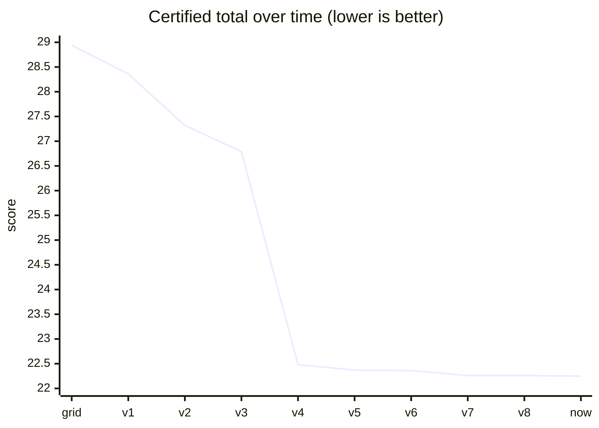
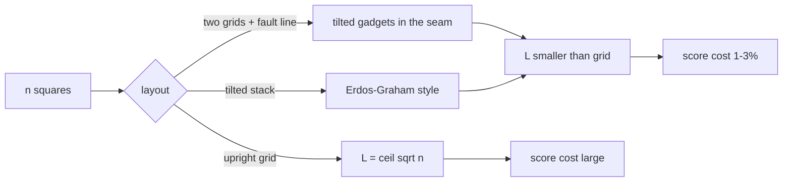
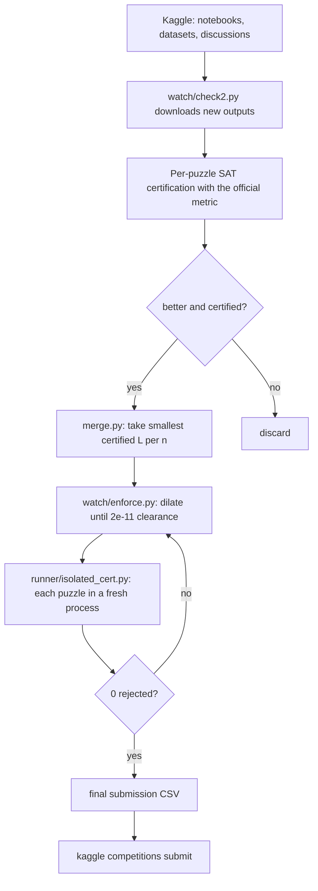

<div align="center">

# 🟦 Squares in Squares

### Packing *n* unit squares into the smallest possible square, for every *n* = 1 … 1000


**[🔎 Open the interactive explorer](docs/index.html)** &nbsp;·&nbsp; **[📄 Project report](PROJECT_REPORT.md)** &nbsp;·&nbsp; **[📊 Per-n data](data_out/quality_by_n.csv)** &nbsp;·&nbsp; **[📦 Best submission](data_out/submission_22.2498820.csv)**

</div>

---

## 📌 Table of contents

1. [The competition in one minute](#-the-competition-in-one-minute)
2. [Where we stand](#-where-we-stand)
3. [Score history](#-score-history)
4. [What decides the score](#-what-decides-the-score)
5. [Quality of every n](#-quality-of-every-n)
6. [Every method we tried](#-every-method-we-tried)
7. [Pipeline](#-pipeline)
8. [Hard-won lessons](#-hard-won-lessons)
9. [Repository map](#-repository-map)
10. [How to reproduce](#-how-to-reproduce)
11. [Where a gain could still come from](#-where-a-gain-could-still-come-from)
12. [Credits and licences](#-credits-and-licences)

---

## 🎯 The competition in one minute

Kaggle's **Squares in Squares** gives 1000 puzzles. Puzzle *n* asks you to place *n* unit squares (side 1) in a container square, with any rotation allowed and no overlaps. The container side is the bounding box of the rotated squares, called **L**.

$$\text{score} = \sum_{n=1}^{1000}\left(\frac{L_n}{\sqrt{n}} - 1\right) \qquad \text{lower is better}$$

A submission is a CSV with 500,500 rows (1 + 2 + … + 1000):

| column | meaning |
|---|---|
| `id` | row counter |
| `n` | puzzle number, 1..1000 |
| `square_id` | label of the square inside the puzzle, 0..n-1 |
| `x`, `y` | centre of the square |
| `angle` | rotation in radians |

The area bound says L ≥ √n, so the cost of a puzzle is the *wasted* fraction of the box. A perfect square n = K² can reach 0 (a K×K grid). The grid baseline puts every n on a ⌈√n⌉ grid and scores **28.94**.

---

## 🏆 Where we stand

<table>
<tr><th>Item</th><th>Value</th></tr>
<tr><td>🟢 <b>Our Kaggle score</b></td><td><b>22.2498820302</b> (submitted 2026-11-05, equals the local score to 9 digits)</td></tr>
<tr><td>Previous submission</td><td>22.2602676085</td></tr>
<tr><td>Grid baseline (start)</td><td>28.9377</td></tr>
<tr><td>Leaderboard top (2026-11-06)</td><td>22.0544 · 22.0871 · 22.1217 · 22.1224</td></tr>
<tr><td>Gap to top</td><td>0.195</td></tr>
<tr><td>Public frontier</td><td>≈ 22.2499, which we match</td></tr>
</table>



---

## 📈 Score history

| # | Certified total | What produced the step |
|--:|--:|---|
| 0 | 28.9377 | Grid baseline |
| 1 | 28.3553 | Our own packings for small n |
| 2 | 27.32 | More own packings plus border extension |
| 3 | 26.79 | Public notebook outputs, per-puzzle merge |
| 4 | 22.4776 | Fault-line packings from public notebooks |
| 5 | 22.3747 | Newer public notebooks |
| 6 | 22.3611 | First Kaggle submission of a merged file |
| 7 | 22.2616 | Merge under the tightened metric |
| 8 | 22.2603 | Clearance fix, then re-merge |
| 9 | **22.2499** | All public notebooks and ~12 datasets, 2e-11 clearance |

> Every gain after step 1 came from **merging other people's public packings with per-puzzle certification**, never from our own search.

---

## 🧮 What decides the score

| Factor | Effect on the score |
|---|---|
| **L** (bounding box) | The *only* thing that counts: `L/√n − 1` per puzzle |
| **x, y** | Place each square. Together they decide how tightly squares pack |
| **angle** | A tilted unit square needs |cos|+|sin| of width, so tilting only pays when many tilted squares lock together |
| **gap** | Squares must not overlap. Kaggle's grader needs ≥ ~1e-11 separating-axis clearance; we enforce **2e-11** (costs ~1e-9 per puzzle) |
| **square_id** | Just a label 0..n-1. No id is "better"; quality belongs to the whole packing |
| **Number format** | Coordinates are floats parsed by pandas; keep them as plain `repr(float)` |



---

## 🌈 Quality of every n

Excess = `L/√n − 1` for each puzzle.

| Tier | Excess | n count | Share of total | Examples |
|---|---|--:|--:|---|
| 🟢 **Perfect** | 0 | 31 | 0 | n = 1, 4, 9, …, 961 (perfect squares) |
| 🔵 **Near perfect** | < 0.4% | 69 | 0.16 | n = K²−1, K²−2 (255, 288, 323, …, 960) |
| 🟡 **Middle** | 0.4 – 1.2% | 162 | 1.29 | 48, 63, 80, 98, 99, 119, 120, … |
| 🟠 **Weak** | 1.2 – 2.5% | 482 | 8.68 | 24 … 999 |
| 🔴 **Bad** | > 2.5% | 256 | 12.12 | all n ≤ 411, mostly small and mid n |

Small-n values (the proven or published optima):

| n | 2 | 3 | 5 | 6 | 10 | 11 | 17 | 18 | 19 | 26 | 27 | 37 | 52 |
|---|--:|--:|--:|--:|--:|--:|--:|--:|--:|--:|--:|--:|--:|
| **L** | 2.0000 | 2.0000 | 2.7071 | 3.0000 | 3.7071 | 3.8771 | 4.6755 | 4.8229 | 4.8856 | 5.6213 | 5.7071 | 6.5986 | 7.7071 |

Score by range of n:

| n range | Score sum | Mean per puzzle |
|---|--:|--:|
| 1 – 100 | 6.3012 | 0.0630 |
| 101 – 300 | 5.4884 | 0.0274 |
| 301 – 600 | 5.3025 | 0.0177 |
| 601 – 1000 | 5.1578 | 0.0129 |

👉 **[Open the interactive explorer](docs/index.html)** (enable GitHub Pages on `/docs` to use it online, or open the file locally). It has tier filters, a hover chart, a search box and a sortable table.

---

## 🧪 Every method we tried

<details open>
<summary><b>Summary table</b> (click to collapse)</summary>

| Method | Idea | Result |
|---|---|---|
| ⬜ Grid + monotone closure | Put n on a ⌈√n⌉ grid; if n+1 fits, n does too | 28.94 → 28.36 |
| 🧱 Border extension | Add an L-shaped border of upright squares to a good K packing to get n = K²+j | Small gains; public notebooks already use it |
| 🔥 Soft-to-rigid annealing (CPU, numba) | Disks → squares, shrink the box | Matches public for n ≲ 70, jams above |
| 🚀 CUDA annealing kernel | One chain per GPU block on a Kaggle T4 | Same plateau |
| ☁️ Hop search on AWS SageMaker | Public Rust `packer hop`; ~1200 searches, ~$10.6 | **0 improvements** |
| 🧩 Gadget search + fault-line DP | Two offset grids joined by a tilted seam (Deotte-style) | Matched public, did not beat it |
| 🏗️ Tilted-stack probe | Erdős–Graham one-block construction | Negative: needs f ≈ 0.87 at K = 31, our table has 0.52 |
| 🔧 Contact-LP unjam on Kaggle GPU | Tilt hundreds of squares ~1e-4 rad, solve an LP over contacts | 21 min, gain **0.000014** |
| 🌐 **Per-puzzle merge of public work** | Take the smallest *certified* L for each n from 98 notebooks + ~12 datasets | **All real gains** |
| 💬 Reading discussions | Metric bug threads, the Soft-to-Rigid paper | Nothing new to merge |

</details>

<details>
<summary><b>Why each own-search method plateaus</b></summary>

- **Annealing / hardening:** the energy landscape has enormous numbers of jammed states for n above ~70. The best known layouts use delicate tilted seams that random search doesn't find.
- **GPU kernel:** faster, but still the same landscape.
- **Hop search:** a local-move search around public packings; the public packings are already local optima.
- **Fault-line DP:** reproducing the leaders' construction reaches their values but not better ones without a richer gadget catalog.
- **Contact LP:** only helps packings that are already almost optimal.
</details>

<details>
<summary><b>Asymptotic picture</b></summary>

The waste of an optimal packing grows like `O(x^{3/5})` for a box of side x (Erdős–Graham, improved by later work). Extrapolating the excess `f ~ K^-0.4` gives roughly **21.6** as the best conceivable total and **≈ 22.18** with realistic constants. So 22.0 needs layouts nobody has published.
</details>

---

## 🔄 Pipeline



---

## 📚 Hard-won lessons

| Lesson | What went wrong | Fix |
|---|---|---|
| 🔴 **Clearance** | A file with ~1e-12 gaps scored **22.3564** on Kaggle but 22.2604 locally | Enforce ≥ 2e-11 SAT clearance (`watch/enforce.py`) |
| 🔴 **Merge by raw L** | After the metric tightened, 357 puzzles were rejected | Merge only per-puzzle *certified* values |
| 🟠 **Order dependence** | Touching squares (~1e-12) are judged differently depending on evaluation order | Certify each puzzle in its own process (`runner/isolated_cert.py`) |
| 🟠 **Concurrent runs** | Two `check2.py` runs corrupted the state files | Never run two at once |
| 🟡 **`np.float64` repr** | CSV contained `np.float64(0.5)` and graded as the grid baseline | Write `repr(float(x))` |
| 🟡 **CUDA shared arrays** | Two same-size arrays aliased, so every move looked neutral | One shared buffer, compile-time size |
| 🟡 **File shadowing** | `bottleneck.py` shadowed pandas' optional dependency | Renamed to `bneck.py` |

---

## 🗂️ Repository map

| Path | What it is |
|---|---|
| `README.md` | This file |
| `PROJECT_REPORT.md` | Short factual report |
| `docs/index.html` | Interactive explorer (tiers, chart, search, table) |
| `data_out/submission_22.2498820.csv` | The submitted file (500,500 rows) |
| `data_out/quality_by_n.csv` | n, L, excess, tier, tilted squares |
| `best_fit_summary.csv` | One row per n up to 2000 (rows > 1000 are outside the competition) |
| `best_fit.csv`, `best_fit_101_500.csv`, `best_fit_501_1000.csv` | Per-square rows for the best packings |
| `sq.py`, `sq2.py`, `hard.py`, `hardr.py`, `chain.py`, `solve.py`, `master*.py` | Own solvers (annealing, hardening, chaining) |
| `gpu*.py`, `make_long.py`, `mkgpu*.py` | CUDA kernels and Kaggle GPU notebook builders |
| `fault/`, `probe/` | Gadget catalogs, fault-line DP, tilted-stack probe |
| `build.py`, `assemble.py`, `merge.py`, `mksub.py` | Packing builders, border extension, per-n merge |
| `watch/check2.py` | Recurring public-notebook check with certification |
| `watch/enforce.py` | Clearance enforcement |
| `runner/` | Official-metric scoring and isolated certification |
| `aws_job/run_hop.py` | SageMaker hop-search driver |

> The larger working data (downloaded third-party notebooks and datasets, metric copies, archives) is **not** committed: it is not ours to redistribute and it is large.

---

## ▶️ How to reproduce

```bash
git clone https://github.com/Samanyu-dev/squares_in_squares.git
cd squares_in_squares
python -m venv .venv && source .venv/bin/activate
pip install numpy pandas numba mpmath scipy

# 1. Inspect the best packing per n
python -c "import pandas as pd; print(pd.read_csv('data_out/quality_by_n.csv').head())"

# 2. Merge several submission CSVs by smallest L per puzzle
python merge.py out.csv a.csv b.csv c.csv

# 3. Make sure the clearance is large enough for Kaggle's grader
#    (see watch/enforce.py: enforce(n, P) returns the dilated packing)

# 4. Certify every puzzle in a fresh process with the official metric
python runner/isolated_cert.py <metric_dir> out.csv out.json

# 5. Submit
kaggle competitions submit -c squares-in-squares -f out.csv -m "message"
```

The official metric lives at `kaggle.com/code/metric/squares-in-squares`; download it into a directory and pass that directory to the runner scripts.

---

## 🔭 Where a gain could still come from

| Source | Realistic size | Notes |
|---|---|---|
| A leader publishing a notebook or dataset | up to 0.2 | The recurring check picks it up within hours |
| New seam shapes for n just above a perfect square (962–967, 901–906, 842–847, …) | thousandths to hundredths | Richer gadget catalog, mixed-angle seams, rectangular MILP refill |
| More Kaggle GPU search | ~1e-5 per run | The contact-LP stage is nearly exhausted |
| Reaching 22.0 | needs unpublished layouts | None of our own methods has produced one |

---

## 🙏 Credits and licences

Our own code is MIT-style; use it freely. The best values in the submission come from the work of many Kaggle competitors, among them Chris Deotte (fault-line DP and gadget catalog), `lightningv08` (CUDA packing search), `alexchilton`, `kirilltym`, `malyshevdanil`, `prvsiyan`, `busyaprime`, `nilanjansaha123`, `jazivxt`, and the exact register of Francisco Couzo (MIT, `franciscouzo/square-packing`). Third-party notebooks and datasets are used under their own licences and are not redistributed here.

<div align="center">

*Built with a lot of patience, a Kaggle T4 and 98 other people's notebooks.*

</div>
